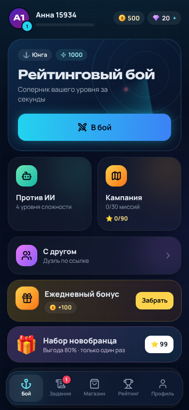
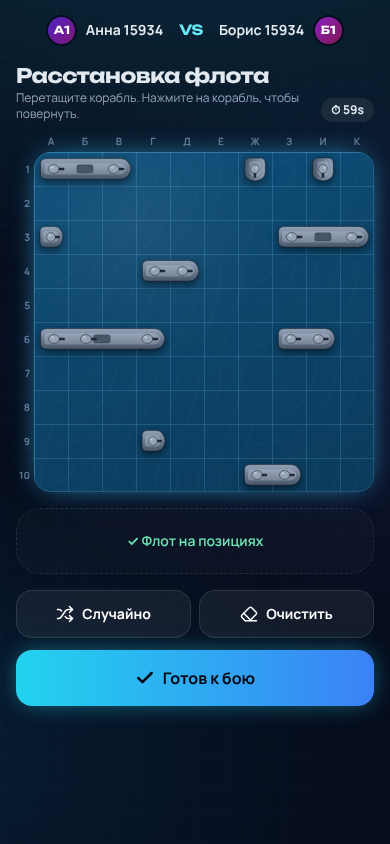
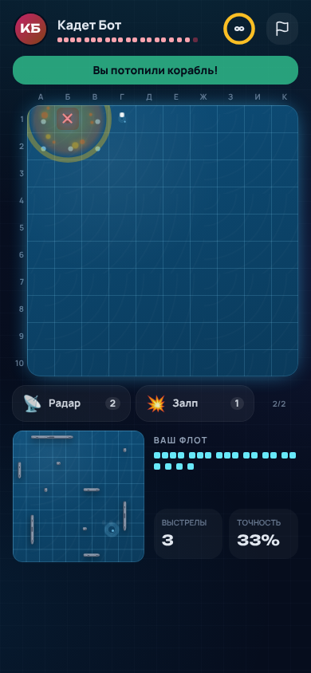
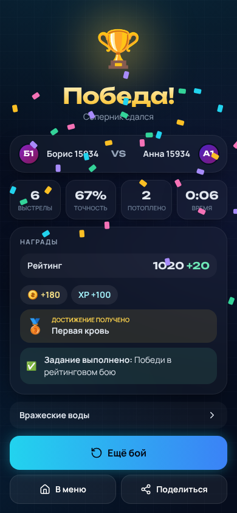
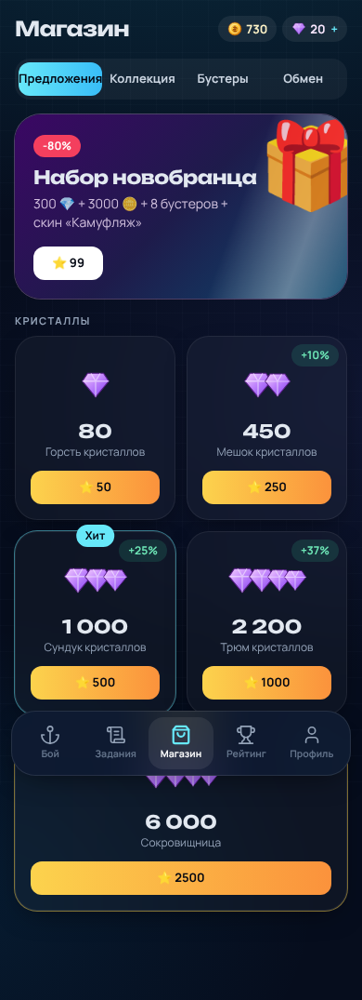
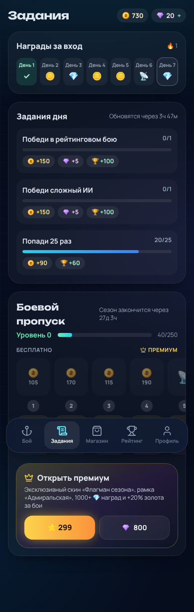

# ⚓ Battleship Online — Telegram Mini App

Морской бой нового поколения прямо в Telegram: PvP в реальном времени, кампания, дуэли с друзьями,
боевой пропуск, коллекция скинов и монетизация через **Telegram Stars**.

Исходное ТЗ: `Battleship_Mini_App_TZ Техническое задание.md`.

Основная версия игры и коллекция «Регент»: [установка релиза, цены, обновление и откат](docs/RELEASE.md).

Подготовка к коммерческому выпуску: [восстановление боёв, надёжность начислений и Stars, проверки и установка](docs/COMMERCIAL_RELEASE.md). Расчёт экономики: [модель на 30 дней](docs/ECONOMY_MODEL.md).

<p>
 
 
 
</p>

---

## Что внутри

### Режимы
| Режим | Описание |
|---|---|
| **Рейтинговый бой** | Матчмейкинг по ELO с расширяющимся окном поиска, таймер хода 30 с, авто-выстрел при бездействии, 30 с на переподключение |
| **Против ИИ** | 4 честных уровня (Новичок → Эксперт). ИИ видит только свои выстрелы, эксперт считает карту вероятностей |
| **Кампания** | 60 миссий в 6 главах, боссы, 3 звезды за миссию. Миссии 31–60 — с особыми правилами: туман войны, без подсказок, ограниченный боезапас, блиц 10 с, засада (ИИ стреляет первым), без бустеров |
| **Дуэль с другом** | 5-значный цифровой код или ссылка; вызов друга из списка друзей со всплывающим приглашением; реванш одной кнопкой |

### Рейтинговые сезоны
- сезон = календарный месяц (UTC), у каждого своё название, цвет и эмблема («Северное сияние», «Шторм»…);
- в конце сезона игроки с 5+ рейтинговыми боями получают награду по званию (золото, кристаллы,
  рамка «Офицер сезона» с Капитана), топ-100 мира — бонус и рамку «Легенда сезона»;
- затем рейтинг мягко сбрасывается: `1000 + (рейтинг − 1000) / 2`; итоги — во всплывающем окне, история — в профиле;
- закрытие сезона идемпотентно и защищено блокировкой БД (безопасно при нескольких экземплярах сервера).

### Защита рейтинга от накрутки
- с одним и тем же соперником рейтинг меняется только в первых 3 боях за сутки;
- если соперник сдался/вышел до 12-го выстрела, победитель рейтинга не получает (сдавшийся — теряет);
- такие «победы» оплачиваются как поражение и не идут в задания и достижения PvP;
- подозрительные пары за сутки видны в админ-панели на вкладке «Обзор».

### Друзья и уведомления
- список друзей: добавление по ID игрока или после боя, заявки, статус «в сети / в бою», вызов на дуэль;
  приглашённые по реферальной ссылке автоматически становятся друзьями;
- уведомления от бота: заявки в друзья, вызов на бой, «друг сыграл по вашей ссылке», напоминания о награде
  за вход, о сгорающей серии и для давно не заходивших — не чаще одного автоматического сообщения в день,
  только днём, с выключателем в профиле; при первом запуске игра просит у Telegram разрешение писать.

### Прогрессия и удержание
- уровни игрока (XP) с наградами за каждый уровень;
- 7-дневные награды за вход, 3 ежедневных задания из пула 10;
- **боевой пропуск** на 30 уровней (бесплатная и премиум-ветка), сезон = календарный месяц;
- 25 достижений, звания по рейтингу (Юнга → Адмирал);
- лидерборды: мир, неделя, друзья; история боёв;
- реферальная программа: приглашённый получает стартовый бонус, пригласивший — награду после первого боя друга.

### Монетизация
- **Кристаллы за Telegram Stars** (5 пакетов, бонус до +50%);
- **Набор новобранца** (одноразовый, 99 ⭐);
- **Премиум-пропуск** (299 ⭐ или 800 💎): эксклюзивные скины, +20% золота;
- косметика за золото/кристаллы: темы поля, скины кораблей, эффекты выстрелов, рамки аватара;
- бустеры (Радар, Залп) — только против ИИ и в кампании, **рейтинг остаётся честным**;
- обмен кристаллов на золото;
- **реклама за награду (Adsgram):** «Бесплатное золото» (+100 🪙, 5 раз в день), «Бесплатный бустер» (2 раза в день),
  «Удвоить награду» после боя (до 300 🪙, 5 раз в день); общий лимит 10 роликов в день и пауза 20 с между ними.

**Подключение Adsgram.** Зарегистрируйтесь на [partner.adsgram.ai](https://partner.adsgram.ai), создайте блок
типа *Rewarded video* для вашего бота и укажите его номер в `ADSGRAM_BLOCK_ID`. Рекомендуется задать
`ADSGRAM_REWARD_SECRET` и в настройках блока указать Reward URL
`https://<backend>/api/ads/adsgram-reward?userid=[userId]&secret=<ADSGRAM_REWARD_SECRET>` — тогда награда
выдаётся только после того, как Adsgram сам подтвердит просмотр. Без блока в режиме разработки
показывается тестовая 5-секундная «реклама».

Оплата в Stars — единственный способ, который Telegram разрешает для цифровых товаров в мини-приложениях.
Зачисление идемпотентно (по `telegram_payment_charge_id`), цена и покупатель проверяются в `pre_checkout_query`.

### Дизайн
Тёмная «морская» тема, стеклянные карточки, векторные корабли со скинами, падающие снаряды со взрывами
и всплесками, процедурные звук и фоновая музыка на WebAudio (без файлов, отдельные темы меню и боя),
обучение при первом запуске, haptic feedback Telegram, поддержка safe-area, RU/EN.

---

## Вирусность
- **Карточка победы в сторис:** после победы кнопка «В сторис» рисует карточку 1080×1920 (статистика,
  поле соперника, сезон) и открывает публикацию в Telegram Stories (`shareToStory`, мобильный Telegram).
  Владельцам Telegram Premium в сторис добавляется ссылка на игру. На компьютере показывается превью
  с кнопками «Скачать» и «Поделиться». Карточки хранятся на сервере 7 дней.
- **Иконка на главном экране:** после третьего боя игра один раз предлагает добавить себя на главный экран
  телефона (`addToHomeScreen`, Bot API 8.0); та же кнопка есть в профиле.

## Админ-панель

Открывается из профиля кнопкой **«Админ-панель»** — она видна только пользователям, чей Telegram ID указан
в `ADMIN_IDS` (через запятую). Владелец `1763619724` — администратор всегда (задан в `backend/src/config.js`), `ADMIN_IDS` добавляет других. Сервер проверяет это на каждом запросе `/api/admin/*`, поэтому прямой
переход по адресу без прав возвращает 403. Свой Telegram ID можно узнать у [@userinfobot](https://t.me/userinfobot).

- **Данные** (аналитика) — средний DAU, MAU, DAU/MAU, новые игроки и доля пришедших по ссылкам,
  удержание D1/D3/D7/D14/D30 и тепловая карта когорт, воронка новичков (обучение → первый бой → возврат
  → 5 боёв → реклама → покупка), выручка, ARPU/ARPPU, конверсия в платящих, просмотры рекламы,
  графики по дням и разбивки по товарам, местам показа рекламы и режимам. Период: 7 / 30 / 90 дней.
  Всё считается по собственным таблицам, без сторонних трекеров.
- **Обзор** — онлайн, бои в процессе, DAU/WAU/MAU, новые игроки, выручка в Stars, платящие, ARPPU, графики за 14 дней.
- **Игроки** — поиск по ID, Telegram ID, @username, имени, реф-коду; карточка игрока с балансом, покупками и боями;
  бан/разбан с причиной (активный бой засчитывается поражением, сессия закрывается);
  корректировка золота, кристаллов, бустеров, рейтинга, премиум-пропуска, выдача/изъятие предметов.
- **Платежи** — все покупки, возврат Stars в один клик с автоматическим изъятием купленного.
- **Рассылка** — сообщение от бота по сегментам (все, активные, не заходившие 7+ дней, платящие, неплатящие)
  с кнопкой «Играть», учётом лимитов Telegram и прогрессом отправки.
- **Журнал** — каждое действие администратора с автором, целью и причиной.

## Правовые документы

Пользовательское соглашение и политика конфиденциальности (RU/EN) лежат в `frontend/src/legal/content.js`
и открываются в приложении (`/legal/terms`, `/legal/privacy`, в том числе без входа), из профиля,
из обучения, в магазине и командами бота `/terms` и `/privacy`. Игрок может сам удалить аккаунт
(Профиль → «Удалить аккаунт»): личные данные стираются, обезличенные записи о боях и платежах остаются.

Заполните `LEGAL_OPERATOR` (кто оператор: ФИО / ИП / компания) и `LEGAL_CONTACT` (e-mail и/или Telegram)
на сервере. **Тексты — шаблон, перед запуском покажите их юристу** под вашу юрисдикцию.

## Архитектура

```
shared/            Правила игры, ИИ, каталог экономики — общий код сервера и клиента
  engine.js        флот, валидация расстановки, выстрелы, обводка потопленных
  ai.js            ИИ четырёх уровней
  catalog.js       цены, награды, задания, пропуск, достижения, кампания
backend/           Node.js + Express + Socket.io + PostgreSQL
  src/game/        авторитарные игровые комнаты, матчмейкинг, дуэли
  src/services/    профиль/награды, матчи и ELO, магазин, бот и платежи
  src/routes/      REST API
  test/            unit + сквозные тесты через реальные сокеты
frontend/          React 18 + Vite + Tailwind + Framer Motion + Zustand
```

**Античит.** Сервер хранит обе доски, клиент получает только результаты своих выстрелов; корабли соперника
раскрываются лишь после окончания боя. Каждое действие (расстановка, выстрел, бустер, ход вне очереди)
проверяется на сервере. Все изменения баланса идут через транзакцию с блокировкой строки пользователя.
Авторизация — проверка подписи `initData` Telegram (HMAC-SHA256) + JWT, в том числе для сокетов.

---

## Локальный запуск

Нужны Node.js 20+ и PostgreSQL.

```bash
npm install                       # ставит зависимости frontend и backend
cp backend/.env.example backend/.env
# укажите DATABASE_URL, оставьте ALLOW_DEV_LOGIN=true
npm run dev                       # API на :5055, фронтенд на :3000 (Vite проксирует /api и /socket.io)
```

Таблицы создаются автоматически при старте сервера.

В обычном браузере (без Telegram) при `ALLOW_DEV_LOGIN=true` появляется вход по имени — удобно для разработки.
В продакшене этот вход отключён всегда.

Тесты:
- `npm test` — тесты сервера: правила, ИИ, экономика, сокеты, платежи, сезоны, реклама
  (нужна база `battleship_test` или переменная `TEST_DATABASE_URL`);
- `npm run e2e` — сквозные сценарии в браузере (Playwright, Chromium, экран телефона): обучение,
  бой с ИИ, рейтинговый бой двумя игроками, дуэли, друзья, админка, сезоны, кампания, удаление аккаунта.
  Сами поднимают сервер и фронтенд; база берётся из `E2E_DATABASE_URL`
  (по умолчанию локальная `battleship`). Первый раз: `npx playwright install chromium`.

CI (`.github/workflows/ci.yml`) запускает оба набора на каждый pull request и push в `main`.

---

## Настройка Telegram

1. В [@BotFather](https://t.me/BotFather): `/newbot` → получите токен.
2. `/newapp` → привяжите Mini App к боту, укажите URL фронтенда и короткое имя (например, `play`).
3. Оплата Stars не требует платёжного провайдера — достаточно токена бота.
4. Заполните переменные окружения backend:

| Переменная | Значение |
|---|---|
| `TELEGRAM_BOT_TOKEN` | токен бота |
| `BOT_USERNAME` | имя бота без `@` |
| `APP_SHORT_NAME` | короткое имя Mini App из `/newapp` |
| `WEBAPP_URL` | URL фронтенда |
| `PUBLIC_URL` | публичный HTTPS URL backend — на него ставится вебхук |
| `WEBHOOK_SECRET` | случайная строка для проверки вебхука |
| `FRONTEND_URL` | разрешённые origin для CORS (через запятую) |
| `JWT_SECRET` | длинная случайная строка |
| `DATABASE_URL`, `DATABASE_SSL=true` | PostgreSQL |
| `ADMIN_IDS` | Telegram id админов (команды `/stats`, `/refund <user_id> <charge_id>`) |

При старте сервер сам регистрирует вебхук, команды и кнопку меню бота.
Для локальной отладки бота вместо вебхука можно включить `BOT_POLLING=true`.

---

## Деплой

**Backend (Railway).** `railway.json` уже настроен: сборка из корня, старт `cd backend && npm start`.
Добавьте PostgreSQL и переменные из таблицы выше, `NODE_ENV=production`.

**Frontend (Vercel).** Root Directory — `frontend`, сборка `npm run build`, выход `dist`.
Фронтенд импортирует `../shared`, поэтому в настройках проекта должна быть включена опция
*Include files outside the root directory in the Build Step* (включена по умолчанию).
Переменные: `VITE_API_URL=https://<backend>/api`, `VITE_WS_URL=https://<backend>`.

---

## ⚠️ Безопасность

Файл `backend/.env` раньше был закоммичен в репозиторий. Он удалён из индекса, но остался в истории git.
**Перевыпустите** токен бота (`/revoke` в BotFather), пароль базы данных и `JWT_SECRET`.
